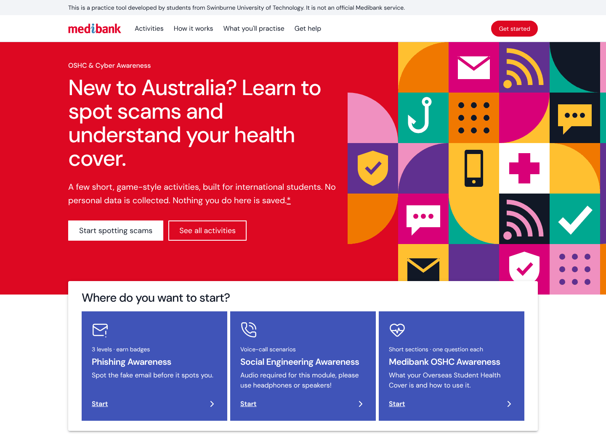
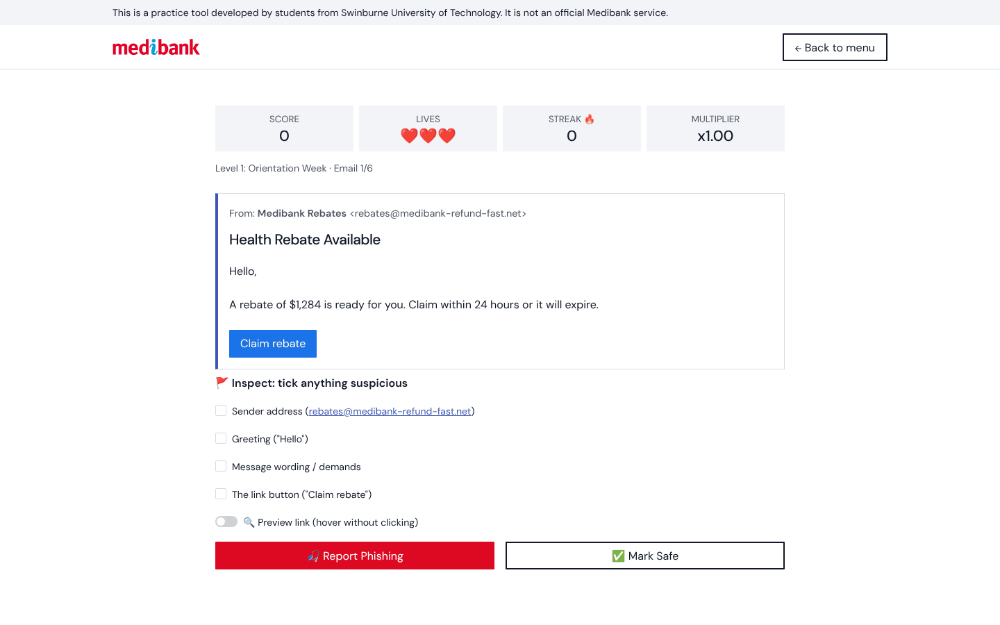

# OSHC & Cyber Awareness

A web app that helps international students in Australia spot scams and understand their Overseas Student Health Cover (OSHC), through three short, game-style activities.

Built by a team of four for COS70008 Technology Innovation Research and Project at Swinburne University of Technology.

> This is a student project, not an official Medibank service. The emails and calls in it are practice examples.



## Why we built it

International students moving to Australia are often unsure how OSHC and healthcare work, and that may make them more susceptible to scams. The app covers both, so students can use it early in their student journey or before they arrive.

## The activities

| Activity | What you do |
|---|---|
| **PhishGuard** | Read emails, flag anything suspicious and preview where links really go. Three levels, with badges and a report card. |
| **Vishguard** | Listen to voice-call scenarios and work out who to trust. In the Advanced level, you speak to the caller using your microphone. |
| **OSHC Awareness** | Learn what OSHC is and how to use it, in 12 short sections with one question each. |



## How to run it

You need Python 3.11 or newer. Run these from the project folder:

```bash
python3 -m venv venv            # Windows: python -m venv venv
source venv/bin/activate        # Windows: venv\Scripts\activate
pip install -r requirements.txt
streamlit run app.py
```

The app opens at http://localhost:8501. Always start it from the project folder, or the theme won't load.

Vishguard needs headphones or speakers. Its Advanced level also needs a microphone and an internet connection.

## How it's put together

Built with Python and [Streamlit](https://streamlit.io), with charts in [Plotly](https://plotly.com/python/).

| Path | What it holds |
|---|---|
| `app.py` | The home page, and the routing into each activity |
| `modules/` | The three activities: `PhishGuard`, `Vishguard` and `oshc` |
| `ui/theme.py`, `assets/theme/` | The shared look across every page |
| `.streamlit/config.toml` | Theme settings |

## Privacy

There are no accounts, the app doesn't ask for your name, and scores last only for your current session.

The one exception is the Advanced Vishguard level. If you record a response there, the audio is sent to Google's speech recognition service to turn it into text.

## The team

- **[Ibrahim](https://github.com/IB-MIL):** connected the three activities into one app, built the home page and UI, and researched the OSHC content.
- **[waltuh9283](https://github.com/waltuh9283):** [add what they built]
- **[rae3264](https://github.com/rae3264):** [add what they built]
- **[M-Mendis](https://github.com/M-Mendis):** [add what they built]

## Credits

- Font: [DM Sans](https://github.com/googlefonts/dm-fonts) (SIL Open Font License)
- Line icons: [Lucide](https://lucide.dev) (ISC License)
- PhishGuard and Vishguard icons in `assets/icons/`: [openclipart.org/336791](https://openclipart.org/336791) by sodruls (edited) and [openclipart.org/16375](https://openclipart.org/16375) by silverstreak
- The Medibank name and logo belong to Medibank.
